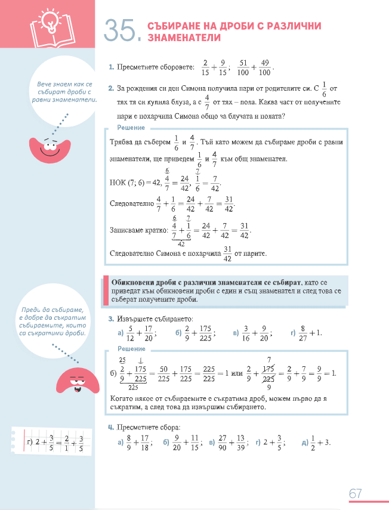

# Събиране на обикновени дроби с равни знаменатели

Урок 35 по математика, 5. клас (стр. 67): събиране на дроби с равни и с различни знаменатели.

## Урокът онлайн
- https://subirane-drobi-5-klas.vercel.app

Вътре има: 3D шоколади, които се въртят с пръст; лаборатория за равни знаменатели; задачата на Симона (1/6 + 4/7) стъпка по стъпка; игра „Ловец на НОК“; машина за съкращаване и всички задачи от урока с проверка, подсказки и решения.

## Учебник

